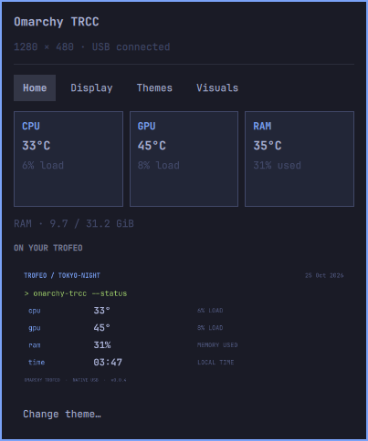

# omarchy-trcc · v0.0.6

**English** · [Español](README.es.md)

Omarchy plugin for the **Thermalright Trofeo Vision 1280×480**. Its own native
C++/Qt USB engine: **TRCC does not need to be installed or run**.



## Features

- **🖥 TR** button in the bar; panel with the colors, fonts, borders and spacing
  of the active Omarchy theme.
- Automatic language from `LC_ALL`, `LC_MESSAGES` and `LANG`: English/Spanish,
  with English as the fallback for other languages. Panel, messages and native
  labels share one catalog; the text in your own themes is kept as is.
- Home view with CPU/GPU/RAM temperature (when sensors exist), load, used memory
  and a preview of the screen; refreshed every two seconds while the panel is
  open.
- Themes tab with a compact list and a single expandable preview; previewing a
  theme does not apply it.
- Import 1280×480 images and JSON themes with metrics; you can remove the
  imported copies without deleting your originals.
- Four native layouts: **Focus, Terminal, Rings and Dots**. The screen also
  follows the system palette automatically.
- CPU and GPU temperature/load, RAM usage, date and clock. A missing sensor is
  shown as `—`.
- Software brightness, 0/90/180/270° rotation, metrics over the visuals and
  game mode (goes back to the metrics panel when CPU >75%).
- Four built-in audio visuals: **Bars, Wave, Rings and Particles**, analyzed
  from the system audio output. It does not use the microphone or store audio.
- Optional accent-color tracking, on by default; when off, a fixed color is
  kept.
- Automatic USB reconnection and a user service. The engine keeps updating the
  screen even when the panel is closed.

## Compatibility

v0.0.6 is tested with **USB `0416:5302`, PM 128, SUB 1, 1280×480**. The engine
checks the panel identity on connect and rejects other geometries. It is not
compatible with the Trofeo 9.16″/11.3″ or with every Thermalright display that
shares the USB ID.

Temperatures come from hwmon (`coretemp`, `k10temp`, `zenpower`, `amdgpu`,
`nouveau`), CPU/RAM load from `/proc` and GPU load from the DRM
`gpu_busy_percent` node. RAM temperature comes from `spd5118`/`jc42` sensors and
shows the highest available value. Power draw in watts is read without root.
The PC total comes, in order, from a USB Corsair HXi/RMi PSU (hwmon
`corsairpsu`), a laptop battery while discharging, or CPU + GPU. GPU power
comes from `amdgpu`/`nouveau` (all GPUs are added). CPU power comes from the
RAPL counter or the `zenpower` module (cores + SoC; not shipped with Omarchy),
only when the system already lets users read them. The kernel keeps RAPL
root-only for security and the plugin never changes permissions, so the CPU
usually shows `—` and the total shows as `≥ X W`. CPU + GPU leaves out the board, drives and PSU
losses. Proprietary NVIDIA telemetry is not included yet. This version draws
its own layouts and visuals; it does not import TRCC `.dc` themes, KarmaViz
shaders or presets.

## Requirements

Building uses tools Omarchy already ships: a C++ compiler (`g++` or `clang++`),
`pkg-config`, Qt 6.7+ with `rcc`, libusb, standard Python and
PipeWire/libpulse. **No CMake, pip packages or virtual environments.** Omarchy
Shell must provide the plugin system and the `qs.Ui` components.

In Omarchy's package list, `clang` and `quickshell` provide the compiler and Qt;
`python-gobject` provides Python; `ddcutil` provides libusb. The install image
includes `base-devel` (GCC and pkgconf) and libpulse. No packages are installed
automatically and the Omarchy installation is not modified.

## Install

```sh
omarchy plugin add https://github.com/gsus67/omarchy-trcc.git --enable
```

When first enabled, the plugin builds its engine automatically and sets up the
user service. Updates rebuild the engine only if the code or its library
versions changed. Temporary build folders are deleted afterwards. It does not
install packages automatically, does not use sudo and does not modify
`/usr/share/omarchy`.

To update:

```sh
omarchy plugin update io.github.gsus67.omarchy-trcc
```

If USB permission is missing, run from a terminal:

```sh
bash ~/.config/omarchy/plugins/io.github.gsus67.omarchy-trcc/setup-usb.sh
```

That optional step asks for sudo to install a `uaccess` rule limited to
`0416:5302`. It does not grant global USB write access. Close any other driver
already using the screen before starting the engine.

## Usage

Click **🖥 TR** to open/close the panel. From a terminal:

```sh
omarchy-shell omarchy-trcc open
omarchy-shell omarchy-trcc view visuals
python ~/.config/omarchy/plugins/io.github.gsus67.omarchy-trcc/bin/trofeo status
python ~/.config/omarchy/plugins/io.github.gsus67.omarchy-trcc/bin/trofeo theme focus
python ~/.config/omarchy/plugins/io.github.gsus67.omarchy-trcc/bin/trofeo visual bars
systemctl --user status omarchy-trcc
```

Custom themes are copied to `~/.local/state/omarchy-trcc/themes/`. Settings and
previews are stored in `~/.local/state/omarchy-trcc/`. The socket lives at
`$XDG_RUNTIME_DIR/omarchy-trcc.sock` and only your user can access it. The
engine checks `~/.local/state/omarchy/current/theme/colors.toml` for changes
every second, even with the panel closed.

## Adding your own themes

In **Themes → Add theme…**, pick a **1280×480** PNG/JPG/WebP image or a JSON
theme file. Selecting a theme expands its preview; **Apply on the Trofeo**
activates it. **Remove copy** deletes only the library copy. Importing does not
change what the screen is showing.

To make a panel with metrics, copy [examples/mi-tema.json](examples/mi-tema.json),
edit its name/text/positions and add it from the picker. You can also import it
from a terminal:

```sh
python ~/.config/omarchy/plugins/io.github.gsus67.omarchy-trcc/bin/trofeo import-theme /path/to/my-theme.json
```

The format uses `schema: 1`, `width: 1280`, `height: 480`, a `name` and an
`elements` list. Each `type: "text"` element defines `text`, `x`, `y`, `width`,
`height` and `fontSize`; it accepts `bold`, `align` (`left`, `center`, `right`)
and `color`. Colors can be `background`, `foreground`, `accent`, `muted`,
`green` (they follow Omarchy) or `#RRGGBB`.

Text can include `{cpu_temp}`, `{gpu_temp}`, `{ram_temp}`, `{cpu_load}`,
`{gpu_load}`, `{ram}`, `{cpu_power}`, `{gpu_power}`, `{power}`, `{time}`, `{date}`
and `{theme}`. Temperatures are numbers in °C; `{ram}` is the used memory
percentage; power values are watts and `{power}` is the PC total (prefixed with
`≥` when a component is missing). Missing sensors show as
`—`.

Optionally, `background` names a 1280×480 image in the same folder as the JSON,
for example `"background": "background.png"`. A normalized copy is stored; the
imported theme does not depend on the original file. `backgroundColor` accepts
the same colors as text. Themes contain only data, no scripts or executable
code. They are not TRCC `.dc` themes.

## Clean system and removal

The install uses only:

- `~/.config/omarchy/plugins/io.github.gsus67.omarchy-trcc/` (checkout managed by Omarchy)
- `~/.config/systemd/user/omarchy-trcc.service` and its enable link
- An `io.github.gsus67.omarchy-trcc` entry in the bar in `shell.json`
- `~/.local/state/omarchy-trcc/` for settings, imported themes, previews and a
  single live image that gets overwritten
- Temporary socket/lock in `$XDG_RUNTIME_DIR`
- Optionally, `/etc/udev/rules.d/70-omarchy-trcc.rules` if you ran
  `setup-usb.sh`

It respects `XDG_CONFIG_HOME` and `XDG_STATE_HOME`. The built binary lives in
`~/.local/state/omarchy-trcc/bin/`; the temporary build is deleted. Normal
plugin removal also removes the engine and its user unit, keeping your settings
and custom themes.

```sh
omarchy plugin remove io.github.gsus67.omarchy-trcc
# Alternative that also deletes your settings and imported themes:
bash ~/.config/omarchy/plugins/io.github.gsus67.omarchy-trcc/uninstall.sh --purge
```

It does not remove shared dependencies, TRCC settings or other plugins. When the
engine stops, the screen keeps the last image sent.

## Development

```sh
# Build, run the native tests and delete the temporary build:
python native_build.py --test
PYTHONDONTWRITEBYTECODE=1 python -m unittest discover -s tests -v
omarchy plugin validate .

# Optional, to keep a development binary:
python native_build.py --output build
```

Building is done only through `native_build.py`, with separate arguments,
without running a shell, and it works with paths containing spaces.

The native test checks packet structure/alignment, geometry, renderers and input
validation without touching USB. The client tests check fragmented responses,
limits and connection errors. The real connection is verified through the
handshake and sending full frames.

License **GPL-3.0-or-later**. Protocol credits in [NOTICE.md](NOTICE.md).
