# omarchy-trcc · v0.0.9

**English** · [Español](README.es.md)

Omarchy plugin for the **Thermalright Trofeo Vision 1280×480**. Its own native
C++/Qt USB engine: **TRCC does not need to be installed or run**.


## Gallery

The panel tabs (Home is shown above; Power is under [Compatibility](#compatibility)):

<table>
  <tr>
    <td>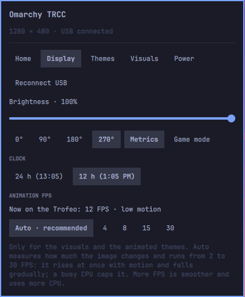</td>
    <td>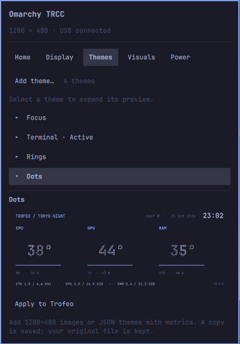</td>
    <td>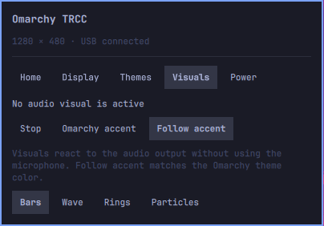</td>
  </tr>
  <tr>
    <td align="center">Display</td>
    <td align="center">Themes</td>
    <td align="center">Visuals</td>
  </tr>
</table>

Built-in layouts as the Trofeo shows them (1280×480, here at half size):

<table>
  <tr>
    <td>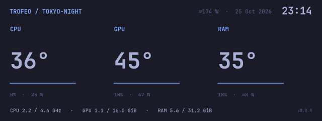</td>
    <td>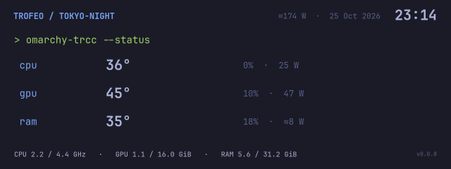</td>
  </tr>
  <tr><td align="center">Focus</td><td align="center">Terminal</td></tr>
  <tr>
    <td>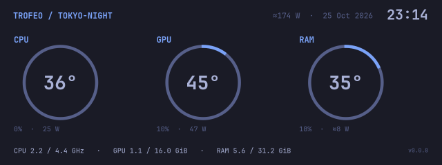</td>
    <td>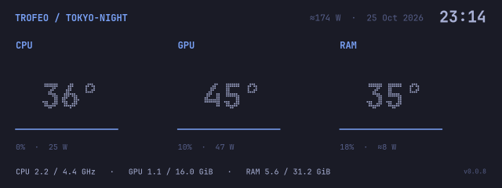</td>
  </tr>
  <tr><td align="center">Rings</td><td align="center">Dots</td></tr>
  <tr>
    <td>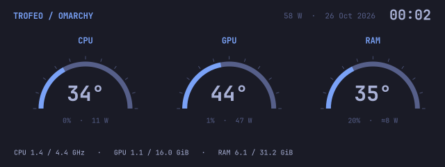</td>
    <td>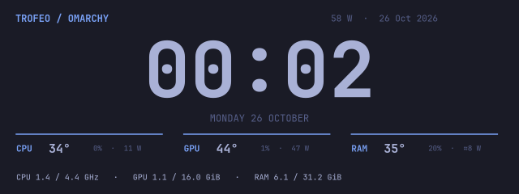</td>
  </tr>
  <tr><td align="center">Gauges</td><td align="center">Clock</td></tr>
  <tr>
    <td>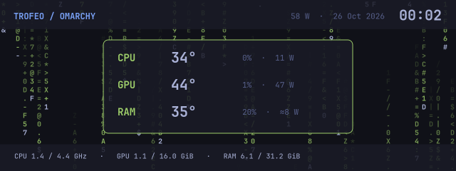</td>
    <td>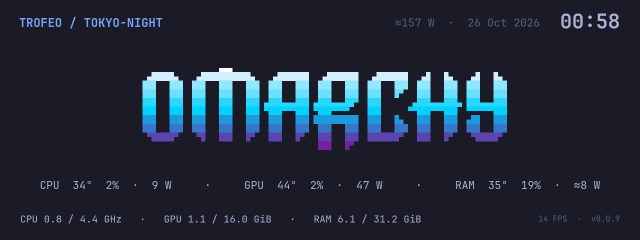</td>
  </tr>
  <tr><td align="center">Matrix</td><td align="center">Omarchy</td></tr>
  <tr>
    <td>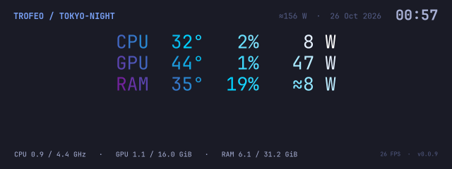</td>
    <td></td>
  </tr>
  <tr><td align="center">Omarchy FX</td><td></td></tr>
</table>

## Features

- **🖥 TR** button in the bar; panel with the colors, fonts, borders and spacing
  of the active Omarchy theme.
- Automatic language from `LC_ALL`, `LC_MESSAGES` and `LANG`: English/Spanish,
  with English as the fallback for other languages. Panel, messages and native
  labels share one catalog; the text in your own themes is kept as is.
- Home view with CPU/GPU/RAM temperature (when sensors exist), load, watts, used
  memory and a preview of the screen; refreshed every two seconds while the
  panel is open.
- Themes tab with a compact list and a single expandable preview that follows
  live values; previewing a theme does not apply it.
- Power tab on desktops without a PSU sensor: estimates the rest of the PC
  (board, RAM, drives, fans, cooling, RGB) and the PSU loss.
- Import 1280×480 images and JSON themes with metrics; you can remove the
  imported copies without deleting your originals.
- Ten native layouts: **Focus, Terminal, Rings, Dots, Gauges, Clock, Matrix,
  Omarchy, Omarchy FX and Picture FX**. The last four are animated, with the
  data on top: Matrix (falling glyphs); Omarchy (your
  `~/.config/omarchy/branding/screensaver.txt` art assembling with a different
  effect each cycle, like the Omarchy screensaver); Omarchy FX (the CPU/GPU/RAM
  rows assembling with those effects); and Picture FX (a picture you choose in
  Themes → Picture FX → **Choose picture…**, turned into text art with Omarchy's
  own `omarchy-transcode-ascii`, exactly like `omarchy branding screensaver
  image`; logos with a transparent background work best. Only the text art is
  kept, not a copy of the picture; up to 20 MB).
- These three use the system's **ttfx**, the engine of the Omarchy
  screensaver, so they get all of its colored effects (fireworks, blackhole,
  matrix, rings…); each effect is followed by a few seconds with live data in
  its final colors. Nothing extra is installed: without ttfx they fall back to
  built-in effects. The screen also follows the system palette automatically.
- Animation FPS in Display: Auto (recommended), 4, 8, 15 or 30, for the visuals
  and the animated layouts only; static layouts send one frame a second. Auto
  runs Omarchy at 15 while the art assembles and 2 while it holds, Matrix at
  15, visuals at 15 with sound and 4 in silence, and 4 whenever the CPU is busy.
- CPU, GPU and RAM temperature with load and watts, CPU clock, VRAM and RAM in
  use, total power, date and clock. A missing sensor is shown as `—`.
- Software brightness, 0/90/180/270° rotation, metrics over the visuals and
  game mode (goes back to the metrics panel when CPU >75%).
- Four built-in audio visuals: **Bars, Wave, Rings and Particles**, analyzed
  from the system audio output. It does not use the microphone or store audio.
- Optional accent-color tracking, on by default; when off, a fixed color is
  kept.
- Automatic USB reconnection and a user service. The engine keeps updating the
  screen even when the panel is closed.

## Compatibility

v0.0.9 is tested with **USB `0416:5302`, PM 128, SUB 1, 1280×480**. The engine
checks the panel identity on connect and rejects other geometries. It is not
compatible with the Trofeo 9.16″/11.3″ or with every Thermalright display that
shares the USB ID.

Temperatures come from hwmon (`coretemp`, `k10temp`, `amdgpu`, `nouveau`,
`i915`, `xe`), CPU/RAM load from `/proc` and GPU load from the DRM
`gpu_busy_percent` node. RAM temperature comes from `spd5118`/`jc42` sensors and
shows the highest available value. With NVIDIA's proprietary driver, GPU power,
temperature and load come from NVML, the library Omarchy installs with
`nvidia-utils` (the one `nvidia-smi` uses).

Power draw in watts is read without root and without changing permissions. The
PC total comes, in order, from a USB Corsair HXi/RMi PSU (hwmon `corsairpsu`), a
laptop battery while discharging, or CPU + GPU. GPU power comes from
`amdgpu`/`nouveau`, the energy counter of Intel discrete GPUs (`i915`/`xe`) or
NVML; all GPUs are added. A sleeping NVIDIA laptop GPU counts as 0 W and is not
woken up. Omarchy keeps the CPU's RAPL energy counter root-only for security;
the optional `setup.sh` step (below) installs a sandboxed system service that
publishes only whole watts once per second, so the plugin gets the CPU power
without access to the counter. Without it the CPU shows `—` and the total shows
as `≥ X W`. The panel shows the total on Home and each component's watts in its
card; the Trofeo shows the total in the layouts' header, next to the date. CPU +
GPU leaves out the board, RAM, drives and PSU losses.

All built-in layouts share one design: the time on top (large in Clock)
with the PC total and the date, then CPU, GPU and RAM. Each row shows the
temperature as its value and, beside it, load and watts (RAM: use). Without a
RAM sensor, RAM shows its use instead. The bottom line shows the CPU clock
(average of the cores / top), the GPU's VRAM and the RAM in use against their
totals.

On a desktop without a PSU sensor or battery the panel adds a **Power** tab to
estimate the rest of the PC. RAM modules (DDR4/DDR5 sensors), NVMe and internal
SATA drives are detected; you mark the motherboard size, fans without and with
RGB (each fan in one of them), air or liquid cooling, RGB strips and the PSU's 80 PLUS rating. With "≈ Include
in total" on, the total becomes `≈ X W`: CPU + GPU plus those parts,
divided by the PSU's efficiency (wall power); the tab lists each part's share. The RAM row always shows its
modules' estimated watts. These are typical values (DDR5 4 W, DDR4 3 W, NVMe
4 W, SATA SSD 2 W, HDD 6 W, fan 1.5 W, RGB fan 3 W, pump 5–7 W, RGB strip 4 W, board
20–40 W), not measurements: no PC sensor reports them.

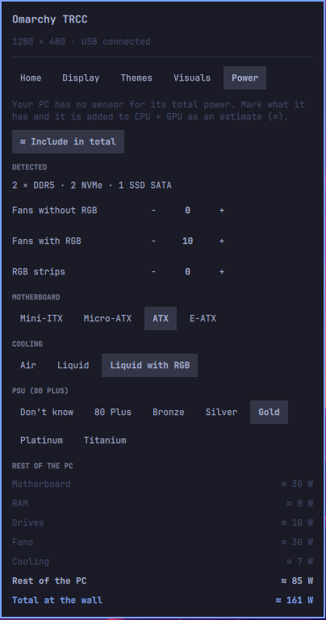

This version draws its own layouts and visuals; it does not import TRCC `.dc`
themes, KarmaViz shaders or presets.

## Requirements

Building uses tools Omarchy already ships: a C++ compiler (`g++` or `clang++`),
`pkg-config`, Qt 6.7+ with `rcc`, libusb, standard Python and
PipeWire/libpulse. **No CMake, pip packages or virtual environments.** Omarchy
Shell must provide the plugin system and the `qs.Ui` components.

In Omarchy's package list, `clang` and `quickshell` provide the compiler and Qt;
`python-gobject` provides Python; `ddcutil` provides libusb. The install image
includes `base-devel` (GCC and pkgconf) and libpulse. No packages are installed
automatically and the Omarchy installation is not modified.

## Install

```sh
omarchy plugin add https://github.com/gsus67/omarchy-trcc.git --enable
```

When first enabled, the plugin builds its engine automatically and sets up the
user service. Updates rebuild the engine only if the code or its library
versions changed. Temporary build folders are deleted afterwards. It does not
install packages automatically, does not use sudo and does not modify
`/usr/share/omarchy`.

To update:

```sh
omarchy plugin update io.github.gsus67.omarchy-trcc
```

For USB permission and the CPU power reading, run once from a terminal:

```sh
bash ~/.config/omarchy/plugins/io.github.gsus67.omarchy-trcc/setup.sh
```

That optional step asks for sudo once and installs only root-owned copies:

- a `uaccess` rule limited to `0416:5302`. It does not grant global USB write
  access. Close any other driver already using the screen before starting the
  engine.
- if the CPU has RAPL, `omarchy-trcc-power.service` and its script
  `/usr/local/libexec/omarchy-trcc-power`. It reads the energy counter once
  per second and writes only whole watts to `/run/omarchy-trcc-power/cpu-watts`,
  which defeats attacks that need fine-grained readings (Platypus,
  CVE-2020-8694); the counter itself stays root-only. It runs without any
  capabilities, network, home or devices, on a read-only system (systemd
  exposure 0.7/10), and never runs files from the plugin folder.

## Usage

Click **🖥 TR** to open/close the panel. From a terminal:

```sh
omarchy-shell omarchy-trcc open
omarchy-shell omarchy-trcc view visuals
python ~/.config/omarchy/plugins/io.github.gsus67.omarchy-trcc/bin/trofeo status
python ~/.config/omarchy/plugins/io.github.gsus67.omarchy-trcc/bin/trofeo theme focus
python ~/.config/omarchy/plugins/io.github.gsus67.omarchy-trcc/bin/trofeo visual bars
systemctl --user status omarchy-trcc
```

Custom themes are copied to `~/.local/state/omarchy-trcc/themes/`. Settings and
previews are stored in `~/.local/state/omarchy-trcc/`. The socket lives at
`$XDG_RUNTIME_DIR/omarchy-trcc.sock` and only your user can access it. The
engine checks `~/.local/state/omarchy/current/theme/colors.toml` for changes
every second, even with the panel closed.

## Adding your own themes

In **Themes → Add theme…**, pick a **1280×480** PNG/JPG/WebP image or a JSON
theme file. Selecting a theme expands its preview; **Apply on the Trofeo**
activates it. **Remove copy** deletes only the library copy. Importing does not
change what the screen is showing.

To make a panel with metrics, copy [examples/mi-tema.json](examples/mi-tema.json),
edit its name/text/positions and add it from the picker. You can also import it
from a terminal:

```sh
python ~/.config/omarchy/plugins/io.github.gsus67.omarchy-trcc/bin/trofeo import-theme /path/to/my-theme.json
```

The format uses `schema: 1`, `width: 1280`, `height: 480`, a `name` and an
`elements` list. Each `type: "text"` element defines `text`, `x`, `y`, `width`,
`height` and `fontSize`; it accepts `bold`, `align` (`left`, `center`, `right`)
and `color`. Colors can be `background`, `foreground`, `accent`, `muted`,
`green` (they follow Omarchy) or `#RRGGBB`.

Text can include `{cpu_temp}`, `{gpu_temp}`, `{ram_temp}`, `{cpu_load}`,
`{gpu_load}`, `{ram}`, `{cpu_power}`, `{gpu_power}`, `{power}`, `{time}`, `{date}`
and `{theme}`. Temperatures are numbers in °C; `{ram}` is the used memory
percentage; power values are watts and `{power}` is the PC total (prefixed with
`≥` when a component is missing). Missing sensors show as
`—`.

Optionally, `background` names a 1280×480 image in the same folder as the JSON,
for example `"background": "background.png"`. A normalized copy is stored; the
imported theme does not depend on the original file. `backgroundColor` accepts
the same colors as text. Themes contain only data, no scripts or executable
code. They are not TRCC `.dc` themes.

## Clean system and removal

The install uses only:

- `~/.config/omarchy/plugins/io.github.gsus67.omarchy-trcc/` (checkout managed by Omarchy)
- `~/.config/systemd/user/omarchy-trcc.service` and its enable link
- An `io.github.gsus67.omarchy-trcc` entry in the bar in `shell.json`
- `~/.local/state/omarchy-trcc/` for settings, imported themes, previews and a
  single live image that gets overwritten
- Temporary socket/lock in `$XDG_RUNTIME_DIR`
- Optionally, if you ran `setup.sh`: `/etc/udev/rules.d/70-omarchy-trcc.rules`,
  `/etc/systemd/system/omarchy-trcc-power.service` and
  `/usr/local/libexec/omarchy-trcc-power` (`uninstall.sh --purge` removes them)

It respects `XDG_CONFIG_HOME` and `XDG_STATE_HOME`. The built binary lives in
`~/.local/state/omarchy-trcc/bin/`; the temporary build is deleted. Normal
plugin removal also removes the engine and its user unit, keeping your settings
and custom themes.

```sh
omarchy plugin remove io.github.gsus67.omarchy-trcc
# Alternative that also deletes your settings and imported themes:
bash ~/.config/omarchy/plugins/io.github.gsus67.omarchy-trcc/uninstall.sh --purge
```

It does not remove shared dependencies, TRCC settings or other plugins. When the
engine stops, the screen keeps the last image sent.

## Development

```sh
# Build, run the native tests and delete the temporary build:
python native_build.py --test
PYTHONDONTWRITEBYTECODE=1 python -m unittest discover -s tests -v
omarchy plugin validate .

# Optional, to keep a development binary:
python native_build.py --output build
```

Building is done only through `native_build.py`, with separate arguments,
without running a shell, and it works with paths containing spaces.

The native test checks packet structure/alignment, geometry, renderers and input
validation without touching USB. The client tests check fragmented responses,
limits and connection errors. The real connection is verified through the
handshake and sending full frames.

License **GPL-3.0-or-later**. Protocol credits in [NOTICE.md](NOTICE.md).
