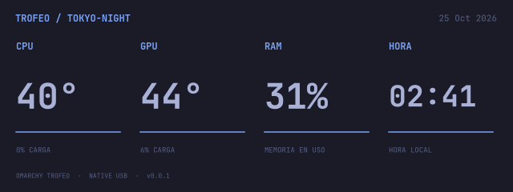

# omarchy-trcc · v0.0.1

Plugin de Omarchy para la **Thermalright Trofeo Vision 1280×480**. Motor USB propio en C++/Qt: **no requiere instalar ni ejecutar TRCC**.



## Funciones

- Botón **🖥 TR** en la barra; panel con los colores, fuentes, bordes y espaciado del tema activo de Omarchy.
- Cuatro diseños nativos: **Focus, Terminal, Rings y Dots**. La pantalla también sigue automáticamente la paleta del sistema.
- Temperatura/carga CPU y GPU, uso de RAM, fecha y reloj. Un sensor no disponible se muestra como `—`.
- Brillo por software, giro de 0/90/180/270°, métricas sobre los visuales y modo juego (vuelve al panel de métricas con CPU >75%).
- Cuatro visuales propios: **Bars, Wave, Rings y Particles**, analizados desde la salida de audio del sistema. No usa el micrófono ni guarda audio.
- Seguimiento opcional del acento, activado inicialmente; cuando se desactiva se conserva un color fijo.
- Reconexión automática USB y servicio de usuario. El motor sigue actualizando la pantalla aunque cierres el panel.

## Compatibilidad

v0.0.1 está probada con **USB `0416:5302`, PM 128, SUB 1, 1280×480**. El motor valida la identidad del panel al conectarse y rechaza otras geometrías. No es compatible con la Trofeo 9,16″/11,3″ ni con todas las pantallas Thermalright que comparten USB ID.

Las temperaturas se leen desde hwmon (`coretemp`, `k10temp`, `zenpower`, `amdgpu`, `nouveau`), la carga de CPU/RAM desde `/proc` y la carga de GPU desde el nodo DRM `gpu_busy_percent`. No incluye aún telemetría propietaria de NVIDIA. Esta versión dibuja diseños y visuales propios; no importa temas `.dc`, shaders KarmaViz ni presets de TRCC.

## Instalación

En Omarchy/Arch se necesitan `cmake`, `gcc`, `pkgconf`, `qt6-base` (Qt 6.7+), `libusb`, `python` y `libpulse` (para `pactl` y `parec`). Omarchy Shell debe ofrecer el sistema de plugins y los componentes `qs.Ui`.

```sh
# Solo si faltan estas dependencias:
omarchy pkg add cmake gcc pkgconf qt6-base libusb python libpulse

git clone https://github.com/gsus67/omarchy-trcc.git
cd omarchy-trcc
bash install.sh
```

El instalador **no instala paquetes**, no usa sudo y no modifica `/usr/share/omarchy`. Compila y prueba el motor, instala el widget y activa un único servicio de usuario. `omarchy plugin add` por sí solo no compila el motor ni configura su servicio: usa `install.sh`.

Si falta permiso USB, ejecuta desde una terminal:

```sh
bash setup-usb.sh
```

Ese paso opcional solicita sudo para instalar una regla `uaccess` limitada a `0416:5302`. No concede acceso global de escritura al USB. Cierra cualquier controlador que ya esté usando la pantalla antes de iniciar el motor.

## Uso

Pulsa **🖥 TR** para abrir/cerrar el panel. Desde una terminal:

```sh
omarchy-shell omarchy-trcc open
omarchy-shell omarchy-trcc view visuals
python bin/trofeo status
python bin/trofeo theme focus
python bin/trofeo visual bars
systemctl --user status omarchy-trcc
```

Ajustes y vistas previas se guardan en `~/.local/state/omarchy-trcc/`. El socket está en `$XDG_RUNTIME_DIR/omarchy-trcc.sock` y solo permite acceso a tu usuario. El motor detecta cambios en `~/.local/state/omarchy/current/theme/colors.toml` cada segundo, incluso con el panel cerrado.

## Sistema limpio y desinstalación

La instalación usa únicamente:

- `~/.config/omarchy/plugins/omarchy-trcc/`
- `~/.config/systemd/user/omarchy-trcc.service` y su enlace de activación
- Una entrada `omarchy-trcc` en la barra de `shell.json`
- `~/.local/state/omarchy-trcc/` para ajustes y cuatro vistas previas
- Socket/bloqueo temporales en `$XDG_RUNTIME_DIR`
- Opcionalmente, `/etc/udev/rules.d/70-omarchy-trcc.rules` si ejecutaste `setup-usb.sh`

Respeta `XDG_CONFIG_HOME` y `XDG_STATE_HOME`. La carpeta de código y `build/` permanecen en el checkout.

```sh
bash uninstall.sh           # Quita widget, servicio y archivos de runtime; conserva ajustes
bash uninstall.sh --purge   # También borra ajustes y ofrece quitar la regla USB propia si existe
```

No elimina dependencias compartidas, configuraciones de TRCC ni otros plugins. Al detener el motor la pantalla conserva la última imagen enviada.

## Desarrollo

```sh
cmake -S . -B build -DCMAKE_BUILD_TYPE=Release
cmake --build build -j2
ctest --test-dir build --output-on-failure
python -m unittest discover -s tests -v
omarchy plugin validate .
```

La prueba nativa verifica estructura/alineación de paquetes, geometría, renderizadores y validación de entradas sin acceder al USB. Las pruebas del cliente verifican respuestas fragmentadas, límites y errores de conexión. La conexión real está comprobada mediante handshake y envío completo de frames.

Licencia **GPL-3.0-or-later**. Créditos del protocolo en [NOTICE.md](NOTICE.md).
